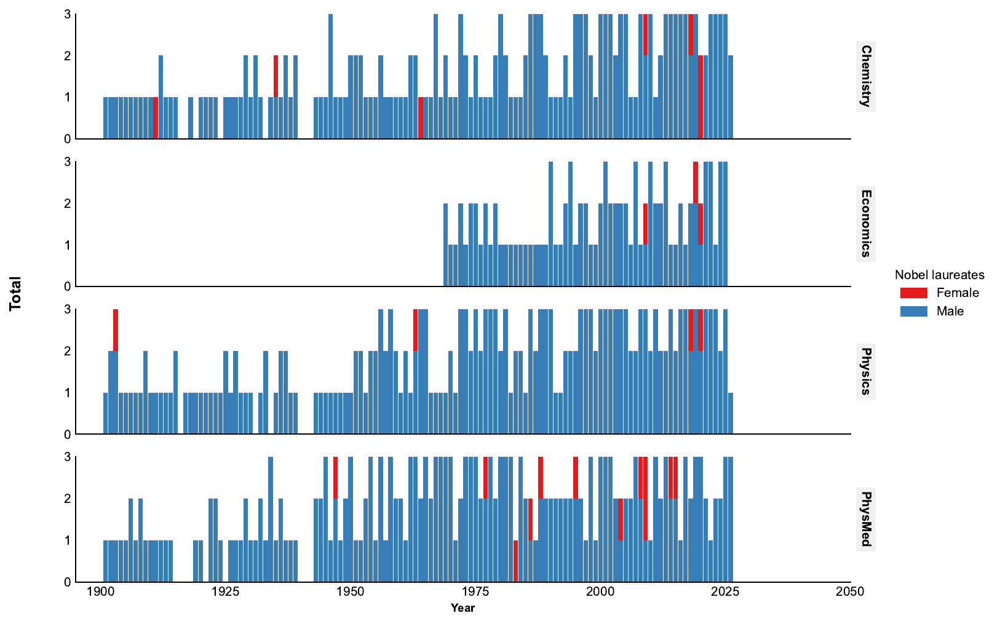
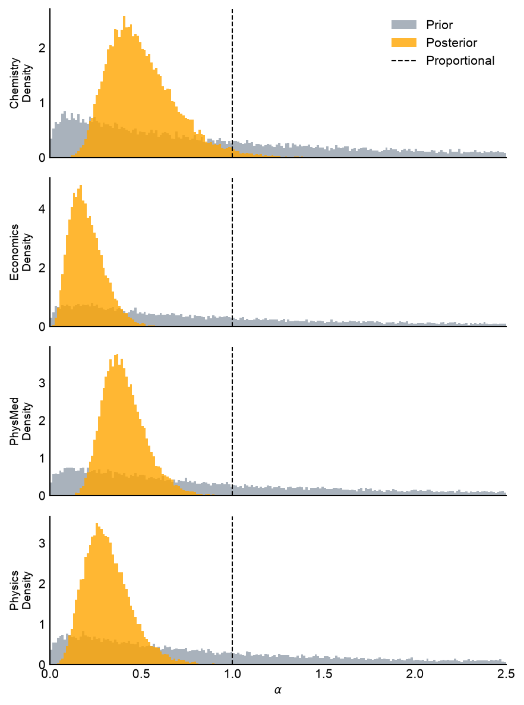
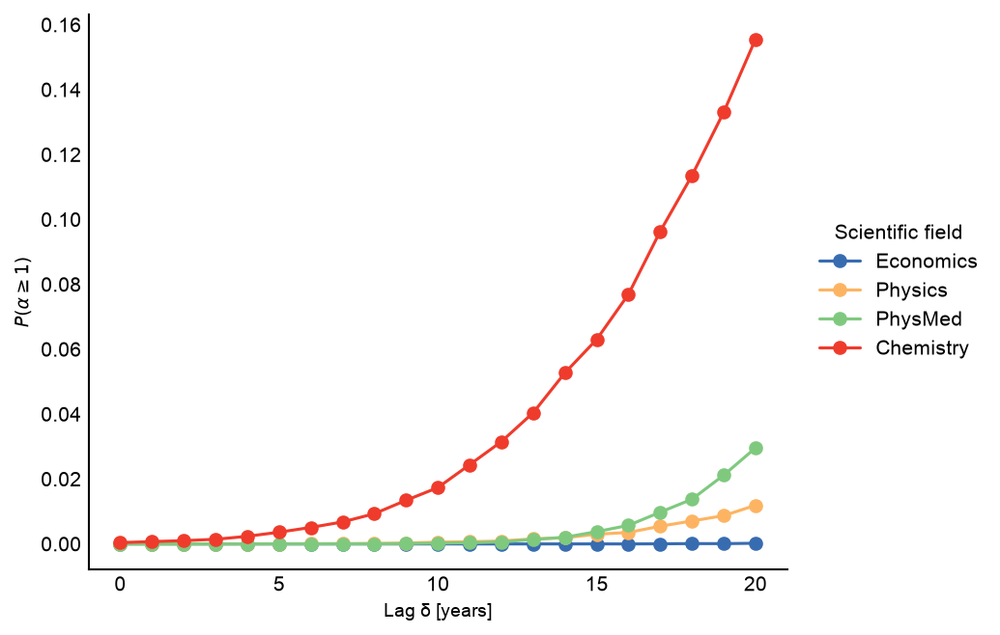

# Quantifying Representation Bias: Nobel Prizes

Does a group's share of observed outcomes match its proportion in the relevant population?

For example, if regional branches accounted for 30% of a company's new hires 15 years ago, but only 15% of today's senior management appointees originally joined through those branches, is that evidence of underrepresentation? Because progression to senior management takes years, the relevant baseline is the historical recruitment cohort—not the distribution of new hires today.

This tool uses Bayesian modeling to quantify departures from proportional representation and the uncertainty around them.

The example implemented here is **gender representation in Nobel Prizes**. It compares female laureate counts in Physics, Chemistry, Physiology or Medicine, and Economics with female representation among senior academics in the corresponding fields, allowing for a lag between research and recognition. The same idea can be applied to other groups or outcomes with appropriate reference data and adaptations to the model.

This work is based on [*Gender bias in Nobel prizes*](https://www.nature.com/articles/s41599-019-0256-3) by Per Lunnemann, Mogens H. Jensen, and Liselotte Jauffred, published in *Palgrave Communications* (now named Humanities and Social Sciences Communications) **5**, article 46 (2019). DOI: [10.1057/s41599-019-0256-3](https://doi.org/10.1057/s41599-019-0256-3). See the paper for the research context and detailed methodology; the model used in this implementation is described [below](#bayesian-model).

## The Idea: What Does α Mean?

The bias parameter **α (alpha)** multiplies a group's reference **odds**, rather than its proportion directly. If `r` is the group's share of the reference population and `θ` is the probability that an observed outcome belongs to that group, the model uses:

```text
logit(θ) = logit(r) + log(α)
θ = α × r / (1 - r + α × r)
```

Here, `logit(p) = log(p / (1 - p))` converts a probability to log-odds. For proportions strictly between 0 and 1, this formulation keeps the modeled probability in that range without clipping.

- **α = 1:** Representation matches the reference proportion.
- **α < 1:** The group is underrepresented relative to that proportion.
- **α > 1:** The group is overrepresented relative to that proportion.

For example, if women make up 20% of the relevant academic workforce, their reference odds are `0.2 / 0.8 = 0.25`. With `α = 0.5`, the modeled odds are halved to `0.125`, corresponding to a probability of about **11.1%**, not 10%. Bayesian inference estimates a distribution for α in each field, rather than just a single number, so uncertainty is part of the result.

This measures a representation gap relative to the chosen baseline; it does **not** by itself identify its causes or establish discrimination by an award committee.

## Nobel Prize Example

### Laureates by Gender

Annual laureate counts show the observed outcomes. The model compares these counts with workforce proportions, rather than expecting a 50/50 split regardless of the reference population.



### Estimated Representation Bias

Prior and posterior distributions of α show how the laureate data update the initial assumptions for each field. The dashed line at `α = 1` marks proportional representation; posterior mass below it indicates evidence of underrepresentation relative to the modeled workforce proportions. The view shows α from 0 to 2.5 using 200 equal-width bins (width 0.0125); the broader lognormal prior extends beyond this window, and densities are normalized using all samples, including those outside the view.



### Sensitivity to the Recognition Lag

The delay sweep estimates `P(α ≥ 1)` for different lags between the reference workforce population and the award year. Small values mean little posterior support for proportional representation or overrepresentation under the model; they are not probabilities that a particular committee discriminated.



The α and lag previews above were regenerated using the log-odds model: **10,000 posterior draws per chain × 2 chains** at lag 10, 20,000 prior draws, and **50,000 posterior draws per chain × 2 chains** at every lag from 0 through 20. Matching PDFs are in `figs/readme/`; [model_run.json](figs/readme/model_run.json) records input hashes, random seeds, sampling settings, and convergence diagnostics. All 22 posterior runs had zero divergences and maximum Rhat below 1.001, though two chains do not by themselves guarantee convergence. The laureate-count plot does not depend on the Bayesian model and is unchanged.

The Python implementation uses PyMC for inference, pandas and NumPy for data processing, SciPy for trend fitting, and Matplotlib and Seaborn for visualization.

## Project Structure

```text
nobelgenderratio/
├── data/
│   ├── femaleNobelsL.csv         # Annual female laureate counts
│   ├── genderDistribution.csv    # Additional reference dataset
│   ├── genderDistribution_v2.csv # Gender data used by the analysis package
│   ├── nobelLaurates.csv         # Laureate names by year and prize
│   ├── nsb20198-tabs03-014.xlsx   # Supporting spreadsheet
│   └── nsb_data_formatted.xlsx   # Formatted supporting spreadsheet
├── figs/                          # Analysis outputs and existing figure assets
│   ├── alphaDistribution.pdf
│   ├── meanVsDelay.pdf             # Earlier delay-sweep figure
│   ├── nobelLaureatesByGender.pdf
│   ├── nobel_figs_2026.zip          # Figure archive
│   ├── probabilityVsDelay.pdf
│   ├── ratioVsYear.pdf
│   └── readme/                     # README snapshots and sampling provenance
│       ├── alphaDistribution.pdf
│       ├── alphaDistribution.png
│       ├── model_run.json
│       ├── nobelLaureatesByGender.png
│       ├── probabilityVsDelay.pdf
│       └── probabilityVsDelay.png
├── scripts/
│   ├── run_analysis.py          # Interactive analysis runner
│   └── test_analysis.py         # Standalone smoke-test runner
├── src/
│   ├── __init__.py
│   └── nobelgenderbias/
│       ├── __init__.py          # Public package exports
│       └── analysis.py          # Data processing, modeling, and plotting
├── tests/
│   ├── test_alpha_distributions.py # Histogram normalization checks
│   ├── test_analysis.py         # Smoke tests
│   ├── test_data_validation.py  # Count, ratio, and lag validation
│   ├── test_delay_sweep.py      # Sweep and plotting regression tests
│   └── test_log_odds_model.py   # Probability, prior, and gradient checks
├── .gitignore                    # Generated-file exclusions
├── alphaDistribution.pdf        # Existing root-level figure
├── ratioVsYear.pdf              # Existing root-level figure
├── pyproject.toml               # Dependencies, tools, and console entry points
├── uv.lock                      # Locked dependencies
└── README.md
```

Local environments, caches, generated package metadata, and editor configuration are omitted from this tree.

## Installation

Python **3.14 or newer** is required, as specified in `pyproject.toml`. Run the following commands from the repository root.

### Using uv (recommended)

Install [uv](https://docs.astral.sh/uv/getting-started/installation/) if needed, then sync the project and its development dependencies:

```bash
uv sync
```

### Using pip

Install the package and its runtime dependencies into your Python environment:

```bash
python -m pip install -e .
```

For pytest-based testing, also install pytest:

```bash
python -m pip install pytest
```

## Input Data

The analysis package loads these files from the repository's `data/` directory:

| File | Purpose |
| --- | --- |
| `genderDistribution_v2.csv` | Academic workforce counts by year, gender, position, and field |
| `nobelLaurates.csv` | Nobel laureate names by year and prize; semicolons separate multiple laureates |
| `femaleNobelsL.csv` | Annual female laureate counts for the four analyzed prizes |

The gender dataset must contain `year`, `gender`, and `position` columns, plus `Physical sciences`, `Life sciences`, and `Social sciences`. The package calculates female representation as `female / (female + male)` and uses physical-sciences ratios for both Physics and Chemistry.

The female-laureate dataset uses `Year`, `Physics_female`, `Chemistry_female`, `Economics_female`, and `Physiology.or.Medicine_female` columns.

`genderDistribution.csv` and the Excel workbooks are additional reference data and are not loaded by `NobelGenderBiasAnalysis.load_data()`.

**Important:** If `femaleNobelsL.csv` is missing, the package generates random synthetic female counts for demonstration. Those results should not be used as research findings.

## Usage

### Run the analysis

Use the installed console entry point:

```bash
uv run nobel-analysis
```

Or run the script directly:

```bash
uv run python scripts/run_analysis.py
```

With a pip installation, use `nobel-analysis` or `python scripts/run_analysis.py` in your environment.

The runner loads data, samples the posterior and prior, saves figures, prints posterior summaries, and asks whether to run the optional delay sweep. Some plotting methods display Matplotlib windows. On macOS, the runner disables PyTensor C++ compilation to work around a linker issue.

### Use the Python API

```python
from nobelgenderbias import NobelGenderBiasAnalysis

analysis = NobelGenderBiasAnalysis()
trace_posterior, trace_prior, prize_names = analysis.run_full_analysis()

# This additional plot is also generated by the command-line runner.
analysis.plot_nobel_laureates_by_gender()
```

For a shorter exploratory run, use the individual steps:

```python
from nobelgenderbias import NobelGenderBiasAnalysis

analysis = NobelGenderBiasAnalysis()
analysis.load_data()
r_matrix, y_matrix, total_matrix, prize_names = analysis.prepare_stan_data()

trace_posterior, trace_prior = analysis.run_inference(
    r_matrix, y_matrix, total_matrix, draws=1000, chains=2
)

analysis.plot_alpha_distributions(trace_posterior, trace_prior, prize_names)
analysis.plot_ratio_vs_year()
analysis.plot_nobel_laureates_by_gender()
```

### Delay sweep

The package exposes `sweep_delay_analysis()`, `plot_delay_sweep()`, and `plot_delay_distributions()`. The runner generates both delay plots from the same posterior samples:

```python
sweep_results = analysis.sweep_delay_analysis(range(21), draws=50_000, chains=2)
analysis.plot_delay_sweep(sweep_results)
analysis.plot_delay_distributions(sweep_results)
```

The sweep evaluates every integer lag from **0 through 20 years**. For an award in year `t`, lag `δ` uses the workforce ratio from `t - δ`: observed ratios are shifted to the corresponding award year, with delayed sigmoid predictions filling missing observations. Laureate counts remain unchanged.

The probability plot estimates **P(α ≥ 1)** separately for each field and lag as `1 - count(α < 1) / sample_count`. Direct sample counts avoid histogram bins crossing the threshold at 1. The four fields share one line plot, using the reference figure's field order and colors.

The distribution plot restores `meanVsDelay.pdf`: four stacked violin plots with inner quartile boxes, ordered Chemistry, Economics, PhysMed, and Physics and colored blue, orange, green, and red. It displays even-numbered lags (0, 2, …, 20 for the default sweep), with a shared lag axis. Each panel uses the original 0–1 vertical range unless posterior samples exceed 1, in which case the range expands to include them.

Sweep defaults are **50,000 draws per chain × 2 chains**, or 100,000 posterior samples per lag, for a nominal probability resolution of 0.00001. Effective precision is lower because MCMC draws are correlated; a zero estimate means no sampled tail events, not proof of zero probability. Increase `draws` or `chains` if the tail remains poorly resolved. This sweep is computationally intensive; it skips prior sampling and does not store the large `theta` arrays. The returned DataFrame retains individual alpha samples in `delay`, `Parameter`, and `value` columns.

## Bayesian Model

For each year `n` and prize field `j`, the model uses:

```text
μ ~ Normal(0, 1)
σ ~ TruncatedNormal(1, 0.5, lower=0)
log(α_j) ~ Normal(μ, σ)
logit(θ_n,j) = logit(r_n,j) + log(α_j)
y_n,j ~ Binomial(total_n,j, θ_n,j)
```

- `μ` is the shared mean of the field-specific log-odds effects; its prior is centered on zero, corresponding to the neutral odds multiplier `α = 1`.
- `σ` is the positive between-field standard deviation of those log-odds effects.
- `α_j = exp(log_alpha_j)` is the field-specific odds multiplier; values below 1 indicate underrepresentation relative to the modeled workforce ratio.
- `r_n,j` is the female workforce ratio at the award year minus the chosen lag, with sigmoid extrapolation used when observed ratios are missing.
- `total_n,j` is the total number of laureates, and `y_n,j` is the female laureate count.

The probability mapping and log-scale hierarchical priors follow the paper. The normal prior on `σ` is explicitly truncated at zero because a standard deviation must be positive. Internally, a noncentered parameterization uses `log_alpha = μ + σ × log_alpha_offset`, with standard-normal offsets, to improve sampling geometry. The public `alpha` and `theta` trace variables are retained; traces also include `sigma`, `log_alpha`, and `log_alpha_offset` unless `var_names` restricts storage.

Exact workforce ratios of 0 and 1 produce exact outcome probabilities of 0 and 1. The model rejects observed counts that contradict these endpoints instead of perturbing the baseline with an arbitrary epsilon. Interior probabilities use the sigmoid of the log-odds expression without output clipping.

**Model migration:** Earlier versions used clipped `r × α` probabilities and priors directly on α. Existing posterior samples and model-dependent figures from that formulation must be regenerated; α now represents an odds multiplier, not a relative proportion. Following the paper's model does not guarantee identical numerical results with different input data or sampling settings.

`run_full_analysis()` and the command-line runner use a **15-year lag** for the posterior shown in `alphaDistribution.pdf`: award year `t` uses workforce ratios from `t - 15`. Pass `delay` to `run_full_analysis()` to override it, for example `analysis.run_full_analysis(delay=15)`.

Standalone `prepare_stan_data()` calls still default to the `senior` position and a 10-year lag for both observed and extrapolated ratios. Pass `delay=15` to match the full analysis, or `delay=0` for same-year workforce ratios. `plot_alpha_distributions()` only plots the supplied traces; it does not set the lag.

### Default sampling settings

| Setting | Value |
| --- | --- |
| Posterior draws per chain (API, full analysis, and CLI) | 10,000 |
| Chains | 2 |
| Tuning samples per chain | 1,000 |
| Target acceptance | 0.99 |
| Prior draws | 20,000 (`draws × chains`) |

`run_inference()` and `run_full_analysis()` (also used by the CLI) share the same default: 10,000 posterior draws per chain with 2 chains. Pass `draws` and `chains` to `run_inference()` to change sampling size. The delay sweep retains its larger default of 50,000 draws per chain, as described above. `sample_priors=False` skips prior sampling and returns `None` for the prior trace; `var_names` limits the posterior variables stored. Priors are defined in `build_pymc_model()`; tuning and target acceptance are configured inside `run_inference()` in `src/nobelgenderbias/analysis.py`.

## Output Files

Relative plot filenames are saved beneath `figs/` in the repository root. Absolute `save_path` values are used directly, and missing parent directories are created automatically.

| File | Generated by | Contents |
| --- | --- | --- |
| `figs/alphaDistribution.pdf` | `run_full_analysis()` | Prior and posterior distributions of the field-specific bias parameters |
| `figs/ratioVsYear.pdf` | `run_full_analysis()` | Observed gender ratios and fitted trends |
| `figs/nobelLaureatesByGender.pdf` | Analysis runner or `plot_nobel_laureates_by_gender()` | Annual male and female laureate counts by prize |
| `figs/probabilityVsDelay.pdf` | `plot_delay_sweep()` | Estimated P(α ≥ 1) versus lag, with one line per scientific field |
| `figs/meanVsDelay.pdf` | `plot_delay_distributions()` | Stacked posterior α violin plots at even-numbered lags |

The regenerated README snapshots and their matching PDFs are under `figs/readme/`. Existing PDFs in the repository root and directly under `figs/` were preserved during the model migration and may still show the previous linear model. Running the analysis again updates the default output paths listed above.

## Tests

Run the pytest tests:

```bash
uv run python -m pytest tests/
```

Or run the standalone smoke checks for data loading, matrix preparation, model construction, and ratio plotting:

```bash
uv run nobel-test
# Equivalent script invocation:
uv run python scripts/test_analysis.py
```

These checks do not run the full posterior-sampling pipeline. The smoke-test runner writes `figs/test_ratioVsYear.pdf`.


## Troubleshooting

- **Missing input files:** Verify the filenames under `data/`, particularly `genderDistribution_v2.csv`. Keep `femaleNobelsL.csv` present to avoid synthetic results.
- **Slow inference or high memory use:** Reduce `draws` or `chains` through the step-by-step API and skip the optional sweep.
- **Sampling diagnostics:** Inspect the returned inference data and review model assumptions and sampler settings before interpreting results.
- **macOS compilation problems in notebooks or custom scripts:** The analysis runner applies a PyTensor workaround before importing the package; direct imports do not apply that workaround automatically.

## Extending the Analysis

To add scientific fields, update the subject and prize mappings in `src/nobelgenderbias/analysis.py`, provide matching input data, and update plots that use fixed prize lists. To experiment with different priors, modify `build_pymc_model()`.
